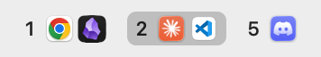

# AeroSpaceIconz

A macOS menu bar item that shows each [AeroSpace](https://github.com/nikitabobko/AeroSpace)
workspace as a pill of the app icons on it. Click a pill to switch to that workspace.

<picture>
  <source media="(prefers-color-scheme: dark)" srcset="docs/pills-dark.png">
  
</picture>

- **Updates instantly** when you switch workspaces, open or close apps, or move windows.
- **One pill per workspace with windows**, plus the one you're on even when it's empty. The
  focused workspace is filled; one visible on another monitor is outlined.
- **One icon per app**, in a stable order: up to 4 per pill, then `+N`. If the bar gets
  wider than 400 pt, other pills drop to fewer icons first.
- **A native status item**: no Dock icon, no window, and it sits in your existing menu bar,
  so you can Cmd-drag it or manage it with [Ice](https://github.com/jordanbaird/Ice).
- **Light when idle**: it listens to `aerospace subscribe` and polls only every 3 s as a
  safety net, and not at all while the screen is locked or asleep.
- **Stock AeroSpace, public APIs only**: it uses just the `aerospace` CLI, needs no changes
  to `aerospace.toml`, and works with SIP on.

## Requirements

- macOS 15 Sequoia or later
- [AeroSpace](https://github.com/nikitabobko/AeroSpace) installed with Homebrew
  (tested with 0.21.3-Beta)
- Xcode Command Line Tools with Swift 6 (`xcode-select --install`); Xcode itself isn't needed

## Install

```bash
git clone https://github.com/YOUR-USERNAME/aerospace-iconz.git
cd aerospace-iconz
make install
```

This builds a release, assembles `AeroSpaceIconz.app`, signs it ad hoc, installs it to
`~/Applications` and launches it. Run `make install` again after pulling changes.

To start it when you log in, right-click the item and choose **Launch at Login**.

AeroSpace has its own menu bar icon. If you want only this one, hide AeroSpace's
(for example, in Ice's "Always Hidden" section).

## Use

- **Click** a pill to switch to that workspace.
- **Right-click** (or Ctrl-click) for **Refresh**, **Launch at Login** and **Quit**.
- While AeroSpace isn't running, the item shows a dimmed `–` and reconnects by itself
  once AeroSpace is back.

## Configure

Every tunable lives in [`Sources/IconzCore/Config.swift`](Sources/IconzCore/Config.swift):
sizes, icon cap, maximum width, timings and colors. Edit it, then run `make install`.

## Uninstall

```bash
make uninstall
```

If you turned on Launch at Login, turn it off from the menu first, or remove it from
System Settings › General › Login Items.

## Develop

```bash
make test
swift build && .build/debug/AeroSpaceIconz --render-png /tmp/iconz
```

`--render-png` draws the current bar in light and dark mode to PNGs, so you can check the
drawing without looking at the menu bar.

- [DESIGN.md](DESIGN.md) is the spec: what the app does, how, and why.
- [AGENTS.md](AGENTS.md) is the working guide (test-first loop, where code goes, traps).

All the logic lives in `IconzCore`, which has no AppKit dependency. It's tested with
Swift Testing against fakes of the AeroSpace CLI and the clock.

## License

[MIT](LICENSE)
